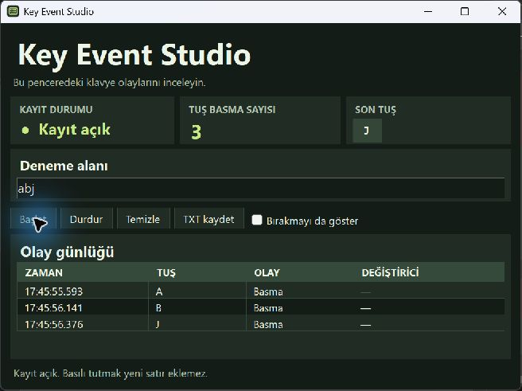
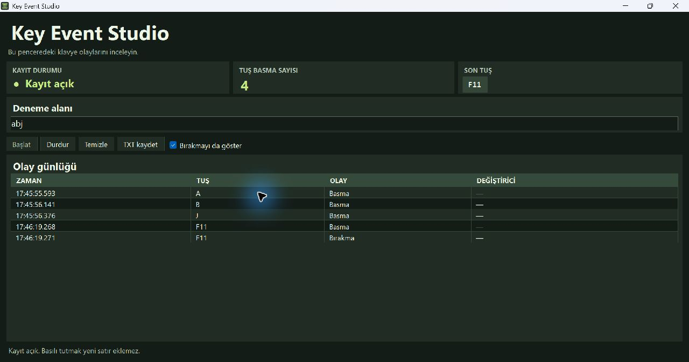

# Key Event Studio

YMH219 için Windows Forms klavye olayları laboratuvarı. Tuş adını, zamanı, olay türünü ve değiştiricileri bir tabloda gösterir. Üst kartlarda kayıt durumu, basma sayısı ve son tuş görünür.

**Öğrenci** · Mustafa Alkhatta, 250541607

## Çalıştırma

Windows 10/11 ve .NET 10 SDK gerekir. Visual Studio'da `KeyEventLogger.csproj` açılıp F5 ile de çalıştırılabilir.

```powershell
git clone https://github.com/MustafaAlkhattab/YMH219-KeyEventLogger.git
cd YMH219-KeyEventLogger
dotnet run -c Release
```

## Kullanım

1. **Başlat** ile kayıt başlar. Deneme alanı otomatik odaklanır. Harf, F4, Home veya F11 gibi tuşları deneyin.
2. Varsayılan görünümde her fiziksel basma bir satırdır. Tuşu basılı tutmak yeni satır üretmez. Tuş bırakıldıktan sonra yeniden basılabilir.
3. **Bırakma olayını da göster** seçeneği ayrı bırakma olayını tabloya ekler. Toplam basma sayacı bu ayardan etkilenmez.
4. **Durdur** kaydı kapatır. **Temizle** tabloyu ve sayacı sıfırlar. **TXT kaydet** görünen kayıtları UTF-8 tablosuna yazar.

## Teknoloji ve sınıflar

C# / .NET 10, Windows Forms, yerel `KeyDown` ve `KeyUp` olayları, UTF-8 dosya yazımı. Harici NuGet paketi yoktur. `KeyWindow`, `KeyPreview` aracılığıyla kendi kontrollerinin klavye olaylarını alır. `CaptureSession` basılı tuşları ve kayıtları yönetir. `KeyPulse` son basılan tuşu küçük bir animasyonla gösterir.

## Ekran görüntüleri




## Sınırlar ve doğrulama

Yakalama bu uygulama penceresi aktifken gerçekleşir. Odağı kaybedince kayıt durur. Tab ve Alt+F4 normal işlevlerini sürdürür. Kayıtlar bellekte son 1000 satırla sınırlıdır. TXT çıktısı tuş olaylarını ve zamanlarını içerir. Deneme alanının metni ayrıca kaydedilmez.

Windows Release derlemesi, Başlat sonrası doğrudan metin girişi, büyütülmüş pencerede tablo odaklı F11 olayı, bırakma seçeneği ve UTF-8 TXT çıktısı kontrol edildi.
