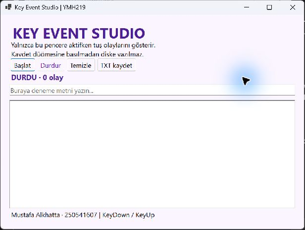
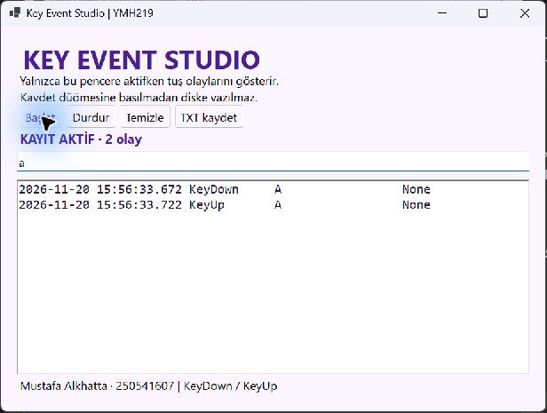

# Key Event Studio — YMH219

Windows Forms içinde klavye olaylarının zaman damgasıyla gözlemlendiği eğitsel uygulama.

**Öğrenci:** Mustafa Alkhatta — **250541607**

## Teknolojiler
C#, .NET 10, Windows Forms, `KeyDown` / `KeyUp`, UTF-8 dosya işlemleri. Harici NuGet paketi yoktur.

## Kurulum ve çalıştırma
Windows 10/11 ve .NET 10 SDK gereklidir. Visual Studio .NET masaüstü geliştirme iş yüküyle `KeyEventLogger.csproj` açılabilir.

```powershell
git clone https://github.com/MustafaAlkhattab/YMH219-KeyEventLogger.git
cd YMH219-KeyEventLogger
dotnet build -c Release
dotnet run -c Release
```

## Kullanım ve temel özellikler
1. **Başlat** ile kayıt açılır; deneme alanına basılan tuşun adı, olay türü, değiştirici tuşları ve milisaniyeli zaman gösterilir.
2. **Durdur** yeni olayların eklenmesini durdurur; durum etiketi ve düğmeler güncellenir.
3. **Temizle** bellekteki ve ekrandaki olayları temizler.
4. **TXT kaydet** kayıt işlemini durdurur, hedef dosyayı seçtirir ve UTF-8 olarak yazar. İptal seçeneği dosya oluşturmaz; erişim hataları gösterilir.
5. Pencere odağı kaybolduğunda kayıt otomatik durur. Yeniden başlatılması gerekir.

Bu uygulama yalnızca kendi formunun olaylarını işler. Global klavye kancası, otomatik başlangıç, gizli kayıt ve ağ üzerinden gönderim içermez.

## Nesne tabanlı tasarım
`KeyLogEntry` bir olayın verisini taşır. `KeyLogSession` kayıt durumu, olay koleksiyonu ve dosyaya yazmayı yönetir. `Form1`, arayüz ve form olaylarını bu sınıfa bağlar; `KeyPreview` alt kontroller odaktayken de formun olayları almasını sağlar.

## Ekran görüntüleri



## Kontroller ve bilinen sınırlamalar
- Windows Release derlemesi 0 hata / 0 uyarı ile geçti.
- Başlat ve A tuşuyla iki zaman damgalı olay oluşturma çalıştırılarak doğrulandı; dosya seçim penceresi açıldı ve iptal edildi.
- Basılı tutulan tuşun işletim sistemi tekrarı ayrı KeyDown olayları üretir. Olay sayısı karakter sayısı değildir.
- Kayıt bellekte tutulur; uzun oturumlarda Temizle kullanılması önerilir.
- Ayrı bilgisayarda çalışma ve dosya kaydetme işleminin tamamı henüz doğrulanmadı.

## Sözlü hazırlık
KeyDown basma, KeyUp bırakma olayını bildirir. KeyPreview formun öncelikle olayı görmesini sağlar; sistemdeki diğer uygulamaları dinlemez. Dosya yazarken erişim ve G/Ç hataları kullanıcıya gösterilir.
